# 基于微信小程序的公考学习平台的设计与实现pf

> 🎓 **计算机毕业设计 · 基于微信小程序的公考学习平台的设计与实现pf**
>
> 本仓库只放**项目介绍 + 运行截图**（截图是站点带水印的原图，存在仓库 `images/` 里）。
>
> 👉 **完整可运行源码 / 数据库脚本 / 部署文档：[点我获取](https://geekcode.top/archives/%E5%9F%BA%E4%BA%8E%E5%BE%AE%E4%BF%A1%E5%B0%8F%E7%A8%8B%E5%BA%8F%E7%9A%84%E5%85%AC%E8%80%83%E5%AD%A6%E4%B9%A0%E5%B9%B3%E5%8F%B0%E7%9A%84%E8%AE%BE%E8%AE%A1%E4%B8%8E%E5%AE%9E%E7%8E%B0pf?utm_source=github)**
>
> 💬 咨询微信：**ir9372**　|　🌐 更多项目：[极客代码 geekcode.top](https://geekcode.top/?utm_source=github)
>
> 📌 项目详情页：<https://geekcode.top/archives/%E5%9F%BA%E4%BA%8E%E5%BE%AE%E4%BF%A1%E5%B0%8F%E7%A8%8B%E5%BA%8F%E7%9A%84%E5%85%AC%E8%80%83%E5%AD%A6%E4%B9%A0%E5%B9%B3%E5%8F%B0%E7%9A%84%E8%AE%BE%E8%AE%A1%E4%B8%8E%E5%AE%9E%E7%8E%B0pf?utm_source=github>

<table><td width="230" align="center"> <b>扫码加微信 ir9372</b></td><td valign="middle">📦 源码 = 项目介绍 + 全部运行截图 + 数据库 + 部署文档 👉 点上方任意截图，直接跳到 <b>极客代码 geekcode.top</b> 详情页</td></table>

---

<h1>基于微信小程序的公考学习平台的设计与实现pf</h1>
<h2>项目概述</h2>

本项目旨在构建一个基于微信小程序的公考学习平台，为准备公务员考试的用户提供便捷的在线学习与测试环境。系统采用前后端分离架构，前端以微信小程序为载体，后端基于 Java 技术栈实现业务逻辑与数据管理。核心功能涵盖试卷管理、试题库维护、在线答题、错题记录、学习足迹追踪以及论坛交流等模块。适用人群主要为参加公务员、事业单位等公职类考试的考生及教务管理人员。通过数字化手段整合学习资源，提升备考效率，解决传统纸质练习难以统计错题、缺乏即时反馈的问题。

<h2>技术架构</h2>

系统整体采用 B/S 架构，分为微信小程序前端、Java 后端服务层和 MySQL 数据库存储层。

<strong>1. 后端架构</strong>
后端基于 Spring Boot 框架构建，利用其自动配置特性简化开发流程。持久层采用 MyBatis-Plus，在 MyBatis 基础上增强 CRUD 操作能力，提高开发效率。安全框架选用 Apache Shiro，负责用户认证与权限控制。模板引擎使用 Thymeleaf，主要用于后台管理页面的渲染（若存在服务端渲染需求）或静态资源处理。API 接口遵循 RESTful 风格，供小程序前端调用。

<strong>2. 前端架构</strong>
小程序前端作为用户交互入口，通过 HTTPS 协议与后端进行数据交互。虽然上下文未明确展示小程序具体代码结构，但根据“vue-integrated”类型及常规实践，推断前端可能采用 Vue.js 语法结合 uni-app 或原生小程序框架进行开发，实现组件化页面构建。

<strong>3. 数据库设计要点</strong>
数据库主要包含以下核心表：

<ul>
<li><strong>用户相关</strong>：<code>yonghu</code> (用户信息), <code>users</code> (管理员/普通用户账户)。</li>
<li><strong>考试相关</strong>：<code>exampaper</code> (试卷), <code>examquestion</code> (试题), <code>exampapertopic</code> (试卷选题关联), <code>dictionaryExamquestion</code> (试题字典/分类)。</li>
<li><strong>记录相关</strong>：<code>examrecord</code> (考试记录), <code>examredetails</code> (答题详情), <code>examrewrongquestion</code> (错题记录)。</li>
<li><strong>内容与互动</strong>：<code>news</code> (公告/新闻), <code>forum</code> (论坛帖子), <code>shipin</code> (视频资源), <code>xuexizuji</code> (学习足迹)。</li>
<li><strong>系统配置</strong>：<code>config</code> (系统参数), <code>dictionary</code> (通用字典表，如性别、科目、题型状态等)。</li>
</ul>

<strong>4. 核心技术选型理由</strong>

<ul>
<li><strong>Spring Boot</strong>: 生态成熟，快速搭建企业级应用，内置 Tomcat 便于部署。</li>
<li><strong>MyBatis-Plus</strong>: 避免大量 XML 配置文件，支持复杂查询与分页插件，适合公考题库的大数据量场景。</li>
<li><strong>Shiro</strong>: 轻量级且灵活，适合中小型项目的权限管理，能有效保护后台敏感数据。</li>
</ul>

<a href="https://geekcode.top/archives/%E5%9F%BA%E4%BA%8E%E5%BE%AE%E4%BF%A1%E5%B0%8F%E7%A8%8B%E5%BA%8F%E7%9A%84%E5%85%AC%E8%80%83%E5%AD%A6%E4%B9%A0%E5%B9%B3%E5%8F%B0%E7%9A%84%E8%AE%BE%E8%AE%A1%E4%B8%8E%E5%AE%9E%E7%8E%B0pf?utm_source=github" title="查看完整源码">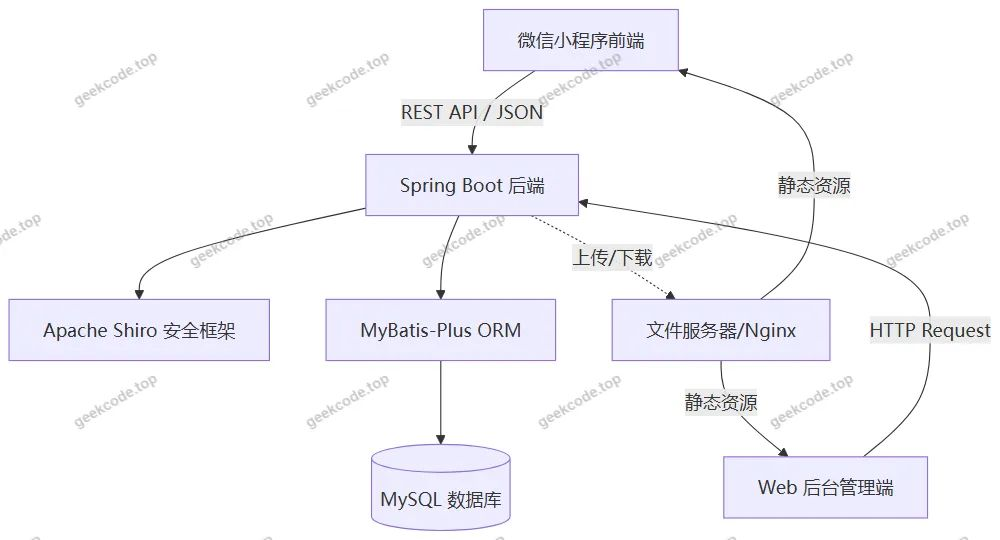</a>

<h2>功能模块</h2>

根据 Controller 列表、路由及截图信息，系统功能划分为小程序用户端和 Web 后台管理端两部分。

<h3>1. 小程序用户端功能</h3>

<em>注：由于上下文仅提供后台路由和 Controller，小程序端具体页面路径未在 <code>app.json</code> 中直接列出，以下功能基于后端提供的 API 能力及公考平台通用逻辑推断得出。</em>

<ul>
<li><strong>用户注册与登录</strong>：通过 <code>/yonghu</code> 相关接口实现用户身份验证。</li>
<li><strong>首页浏览</strong>：展示轮播图 (<code>config</code>/<code>dictionary</code>)、最新公告 (<code>news</code>) 及推荐视频 (<code>shipin</code>)。</li>
<li><strong>在线考试/练习</strong>：</li>
<li>选择试卷：从 <code>exampaper</code> 获取试卷列表。</li>
<li>答题界面：加载 <code>examquestion</code> 题目，提交答案至 <code>examredetails</code>。</li>
<li>查看结果：生成 <code>examrecord</code> 记录。</li>
<li><strong>错题本管理</strong>：查看 <code>examrewrongquestion</code> 中的历史错题，进行针对性复习。</li>
<li><strong>学习足迹</strong>：记录用户访问过的知识点或题目，对应 <code>xuexizuji</code> 表。</li>
<li><strong>论坛社区</strong>：发布帖子、评论交流，对应 <code>forum</code> 模块。</li>
<li><strong>个人中心</strong>：修改个人信息、查看收藏内容等。</li>
</ul>
<h3>2. Web 后台管理端功能</h3>

后台是系统的核心管理枢纽，具备完整的 CRUD（增删改查）功能。

<ul>
<li><strong>系统基础配置</strong>：</li>
<li><strong>字典管理</strong>：维护系统枚举值，包括性别 (<code>dictionarySex</code>)、科目 (<code>dictionaryKemu</code>)、题型 (<code>dictionaryExamquestion</code>)、试卷类型 (<code>dictionaryExampaper</code>)、论坛状态 (<code>dictionaryForumState</code>)、视频分类 (<code>dictionaryShipin</code>)、学习足迹类型 (<code>dictionaryXuexizuji</code>)、组卷方式 (<code>dictionaryZujuan</code>) 等。</li>
<li><strong>参数配置</strong>：管理系统全局变量 (<code>config</code>)，如轮播图设置、网站标题等。</li>
<li><strong>用户管理</strong>：</li>
<li><strong>管理员管理</strong>：对 <code>users</code> 表进行操作，管理后台登录账号。</li>
<li><strong>学员管理</strong>：对 <code>yonghu</code> 表进行操作，查看和管理小程序注册用户信息。</li>
<li><strong>题库与试卷管理</strong>：</li>
<li><strong>试题管理</strong>：录入、编辑、删除单道试题 (<code>examquestion</code>)。</li>
<li><strong>试卷管理</strong>：创建试卷 (<code>exampaper</code>)，定义考试时间、总分等属性。</li>
<li><strong>试卷选题</strong>：将特定试题关联到指定试卷 (<code>exampapertopic</code>)，支持手动选题或自动组卷。</li>
<li><strong>考试数据监控</strong>：</li>
<li><strong>考试记录</strong>：查看所有用户的考试概况 (<code>examrecord</code>)。</li>
<li><strong>答题详情</strong>：深入分析单次考试的每一题作答情况 (<code>examredetails</code>)。</li>
<li><strong>错题分析</strong>：统计高频错题，辅助教学改进 (<code>examrewrongquestion</code>)。</li>
<li><strong>内容运营管理</strong>：</li>
<li><strong>公告资讯</strong>：发布和维护新闻公告 (<code>news</code>)。</li>
<li><strong>视频资源</strong>：上传和管理备考视频资料 (<code>shipin</code>)。</li>
<li><strong>论坛管理</strong>：审核帖子、管理用户发言 (<code>forum</code>)。</li>
<li><strong>学习足迹管理</strong>：查看和分析用户的学习行为轨迹 (<code>xuexizuji</code>)。</li>
<li><strong>文件服务</strong>：通过 <code>FileController</code> 处理图片、视频等文件的上传与存储。</li>
</ul>
<h2>用户角色与权限</h2>

系统主要涉及两类角色：超级管理员（后台管理者）和普通用户（小程序学员）。权限控制由 Apache Shiro 框架实现。

<h3>1. 超级管理员 (Admin)</h3>
<ul>
<li><strong>访问入口</strong>：Web 后台管理系统。</li>
<li><strong>权限范围</strong>：拥有最高权限，可访问所有后台路由。</li>
<li><strong>全量数据管理</strong>：可对试题、试卷、用户、公告、视频、论坛内容进行新增、修改、删除和查询。</li>
<li><strong>系统配置权</strong>：可修改字典表项、系统参数配置。</li>
<li><strong>数据统计权</strong>：可查看考试记录、答题详情、错题分布等统计数据。</li>
<li><strong>账号管理权</strong>：可管理其他管理员账号及重置普通用户密码。</li>
</ul>
<h3>2. 普通用户 (Yonghu)</h3>
<ul>
<li><strong>访问入口</strong>：微信小程序前端。</li>
<li><strong>权限范围</strong>：受限权限，仅能操作与自己相关的数据。</li>
<li><strong>个人数据读写</strong>：注册、登录、修改个人资料。</li>
<li><strong>只读公共数据</strong>：浏览公告、观看视频、查看论坛公开帖子、获取试卷和试题内容。</li>
<li><strong>私有数据写入</strong>：提交答卷、生成考试记录、添加学习足迹、发布自己的论坛帖子。</li>
<li><strong>数据隔离</strong>：只能查看自己的错题本 (<code>examrewrongquestion</code>) 和考试记录 (<code>examrecord</code>)，无法查看他人数据。</li>
</ul>
<h3>3. 权限矩阵示例</h3>
<table>
<thead>
<tr>
<th align="left">功能模块</th>
<th align="center">超级管理员 (Web)</th>
<th align="center">普通用户 (小程序)</th>
</tr>
</thead>
<tbody><tr>
<td align="left">试题/试卷管理</td>
<td align="center">✅ (CRUD)</td>
<td align="center">❌ (仅读取)</td>
</tr>
<tr>
<td align="left">用户信息管理</td>
<td align="center">✅ (CRUD)</td>
<td align="center">❌ (仅修改自己)</td>
</tr>
<tr>
<td align="left">查看考试记录</td>
<td align="center">✅ (全部)</td>
<td align="center">✅ (仅自己)</td>
</tr>
<tr>
<td align="left">发布/管理公告</td>
<td align="center">✅ (CRUD)</td>
<td align="center">❌ (仅读取)</td>
</tr>
<tr>
<td align="left">论坛发帖/评论</td>
<td align="center">✅ (审核/删除)</td>
<td align="center">✅ (发布/回复)</td>
</tr>
<tr>
<td align="left">系统字典配置</td>
<td align="center">✅ (CRUD)</td>
<td align="center">❌</td>
</tr>
<tr>
<td align="left">错题本查看</td>
<td align="center">✅ (统计分析)</td>
<td align="center">✅ (复习查看)</td>
</tr>
</tbody></table>
<h2>项目特色与创新点</h2>
<ol>
<li>
<strong>闭环式学习管理体系</strong>：
   项目不仅提供试题练习，还集成了“错题本”(<code>examrewrongquestion</code>) 和“学习足迹”(<code>xuexizuji</code>) 功能。通过分析用户的答题详情(<code>examredetails</code>)，自动归集错题，并结合学习足迹追踪知识点的掌握程度，形成“练习-诊断-复习”的完整闭环，区别于简单的题库刷题软件。

</li>
<li>
<strong>多维度的内容聚合</strong>：
   除了传统的图文试题，系统整合了视频资源(<code>shipin</code>) 和论坛社区(<code>forum</code>)。这种多媒体融合的方式满足了考生碎片化时间看视频解析、在社区寻求心理支持和解题思路的需求，提升了用户粘性。

</li>
<li>
<strong>灵活的字典驱动架构</strong>：
   后端设计了大量的字典表（如 <code>dictionaryKemu</code>, <code>dictionaryZujuan</code>, <code>dictionaryExamquestion</code> 等），使得系统具有极高的可扩展性。当公考科目变化或新增题型时，管理员只需在后台维护字典数据，无需修改代码即可适应新的业务规则。

</li>
<li>
<strong>细粒度的数据分析能力</strong>：
   后台提供了从“考试记录”到“答题详情”再到“错题表”的多层级数据视图。管理员不仅可以宏观查看通过率，还能微观分析某一道题的错误率，为优化题库质量提供数据支撑。

</li>
</ol>
<h2>部署环境</h2>

为确保系统正常运行，需准备以下软硬件环境：

<strong>1. 硬件环境</strong>

<ul>
<li>CPU: Intel Core i5 及以上或同等性能处理器</li>
<li>内存: 8GB RAM 及以上</li>
<li>硬盘: 至少 50GB 可用空间（用于存储数据库备份及上传的视频/图片资源）</li>
</ul>

<strong>2. 软件环境</strong>

<ul>
<li><strong>操作系统</strong>: Windows 10/11, Linux (CentOS 7+/Ubuntu 18+) 或 macOS</li>
<li><strong>JDK</strong>: Java Development Kit 1.8 (JDK 8) 或更高版本（Spring Boot 2.x 通常要求 JDK 8+）</li>
<li><strong>数据库</strong>: MySQL 5.7 或 MySQL 8.0 Community Edition</li>
<li><strong>构建工具</strong>: Maven 3.6+ (用于后端依赖管理)</li>
<li><strong>Web 服务器</strong>: Nginx (可选，用于反向代理和静态资源加速) 或直接使用 Spring Boot 内置的 Tomcat</li>
<li><strong>前端开发工具</strong>: </li>
<li>Node.js (v14.x 或 v16.x LTS 版本，用于编译 Vue/Uni-app 代码)</li>
<li>微信开发者工具 (WeChat Developer Tools) (用于小程序调试与预览)</li>
<li>Visual Studio Code 或 IntelliJ IDEA (代码编辑器)</li>
</ul>

<strong>3. 关键配置说明</strong>

<ul>
<li><strong>application.yml</strong>: 需配置 MySQL 连接 URL、用户名、密码；配置 Shiro 密钥；配置文件上传路径。</li>
<li><strong>Nginx 配置</strong>: 若生产环境部署，需配置 SSL 证书以支持 HTTPS，因为微信小程序强制要求接口使用 HTTPS。</li>
<li><strong>防火墙</strong>: 开放 8080 (默认后端端口) 及 443/80 端口供外部访问。</li>
</ul>
<h2>五、技术特性</h2>
<ul>
<li>前后端集成部署，前端资源打包至后端 static 目录</li>
<li>使用 MyBatis-Plus 简化数据访问层开发</li>
<li>集成 Shiro 权限框架实现角色权限控制</li>
</ul>
<h2>六、功能模块截图</h2>
<h3>微信小程序用户端</h3>
<h4>后台-错题表</h4>

<a href="https://geekcode.top/archives/%E5%9F%BA%E4%BA%8E%E5%BE%AE%E4%BF%A1%E5%B0%8F%E7%A8%8B%E5%BA%8F%E7%9A%84%E5%85%AC%E8%80%83%E5%AD%A6%E4%B9%A0%E5%B9%B3%E5%8F%B0%E7%9A%84%E8%AE%BE%E8%AE%A1%E4%B8%8E%E5%AE%9E%E7%8E%B0pf?utm_source=github" title="查看完整源码">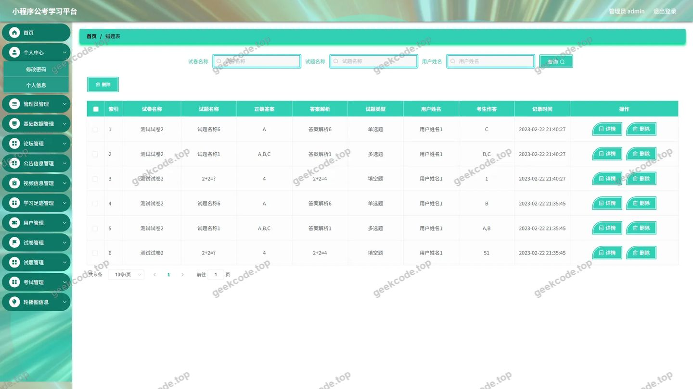</a>

<h4>后台-答题详情表</h4>

<a href="https://geekcode.top/archives/%E5%9F%BA%E4%BA%8E%E5%BE%AE%E4%BF%A1%E5%B0%8F%E7%A8%8B%E5%BA%8F%E7%9A%84%E5%85%AC%E8%80%83%E5%AD%A6%E4%B9%A0%E5%B9%B3%E5%8F%B0%E7%9A%84%E8%AE%BE%E8%AE%A1%E4%B8%8E%E5%AE%9E%E7%8E%B0pf?utm_source=github" title="查看完整源码">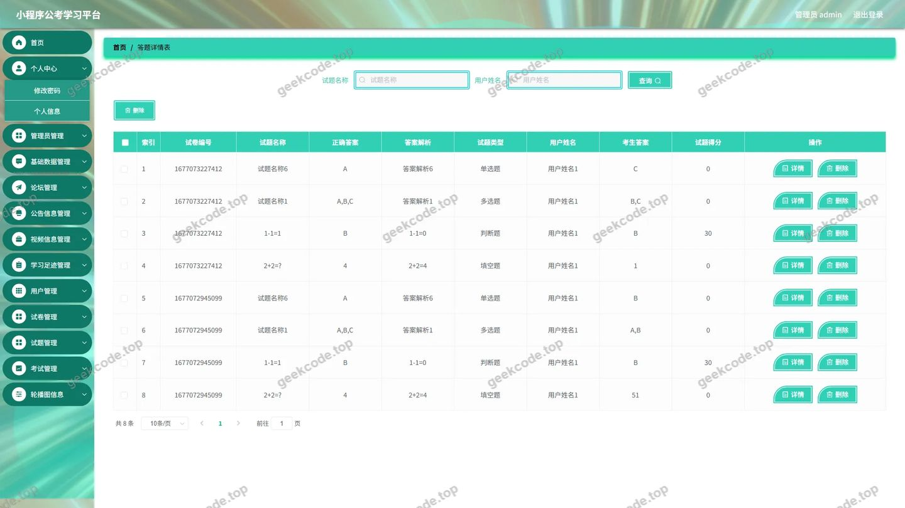</a>

<h4>后台-登录页</h4>

<h4>后台-公告信息</h4>

<a href="https://geekcode.top/archives/%E5%9F%BA%E4%BA%8E%E5%BE%AE%E4%BF%A1%E5%B0%8F%E7%A8%8B%E5%BA%8F%E7%9A%84%E5%85%AC%E8%80%83%E5%AD%A6%E4%B9%A0%E5%B9%B3%E5%8F%B0%E7%9A%84%E8%AE%BE%E8%AE%A1%E4%B8%8E%E5%AE%9E%E7%8E%B0pf?utm_source=github" title="查看完整源码">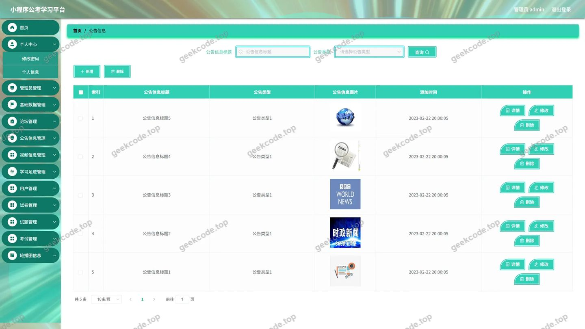</a>

<h4>后台-考试记录表</h4>

<a href="https://geekcode.top/archives/%E5%9F%BA%E4%BA%8E%E5%BE%AE%E4%BF%A1%E5%B0%8F%E7%A8%8B%E5%BA%8F%E7%9A%84%E5%85%AC%E8%80%83%E5%AD%A6%E4%B9%A0%E5%B9%B3%E5%8F%B0%E7%9A%84%E8%AE%BE%E8%AE%A1%E4%B8%8E%E5%AE%9E%E7%8E%B0pf?utm_source=github" title="查看完整源码">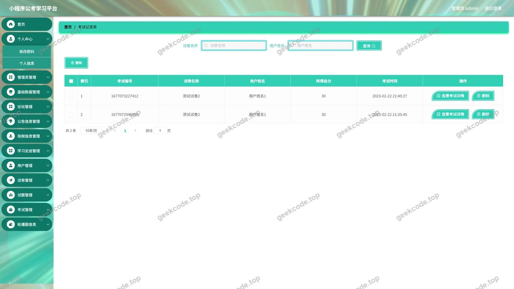</a>

<h4>后台-视频信息</h4>

<a href="https://geekcode.top/archives/%E5%9F%BA%E4%BA%8E%E5%BE%AE%E4%BF%A1%E5%B0%8F%E7%A8%8B%E5%BA%8F%E7%9A%84%E5%85%AC%E8%80%83%E5%AD%A6%E4%B9%A0%E5%B9%B3%E5%8F%B0%E7%9A%84%E8%AE%BE%E8%AE%A1%E4%B8%8E%E5%AE%9E%E7%8E%B0pf?utm_source=github" title="查看完整源码">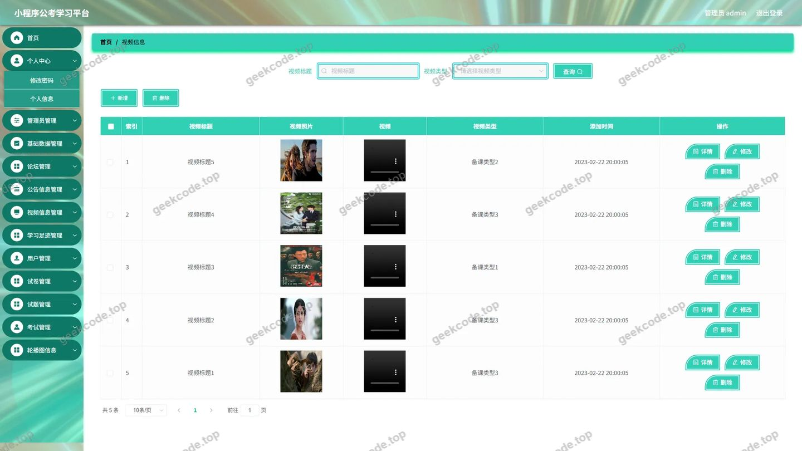</a>

<h4>后台-试卷表</h4>

<a href="https://geekcode.top/archives/%E5%9F%BA%E4%BA%8E%E5%BE%AE%E4%BF%A1%E5%B0%8F%E7%A8%8B%E5%BA%8F%E7%9A%84%E5%85%AC%E8%80%83%E5%AD%A6%E4%B9%A0%E5%B9%B3%E5%8F%B0%E7%9A%84%E8%AE%BE%E8%AE%A1%E4%B8%8E%E5%AE%9E%E7%8E%B0pf?utm_source=github" title="查看完整源码">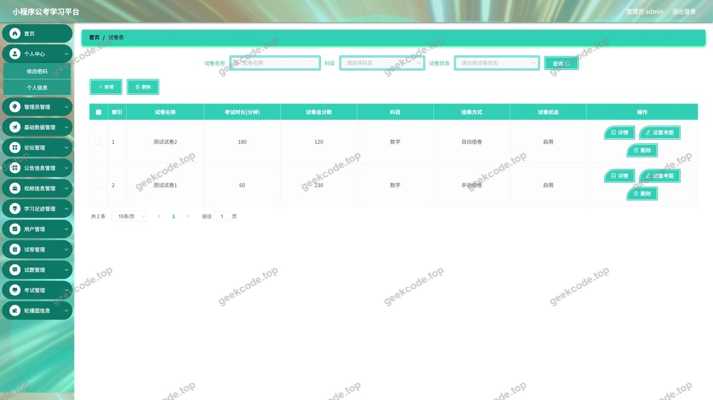</a>

<h4>后台-试卷选题</h4>

<a href="https://geekcode.top/archives/%E5%9F%BA%E4%BA%8E%E5%BE%AE%E4%BF%A1%E5%B0%8F%E7%A8%8B%E5%BA%8F%E7%9A%84%E5%85%AC%E8%80%83%E5%AD%A6%E4%B9%A0%E5%B9%B3%E5%8F%B0%E7%9A%84%E8%AE%BE%E8%AE%A1%E4%B8%8E%E5%AE%9E%E7%8E%B0pf?utm_source=github" title="查看完整源码">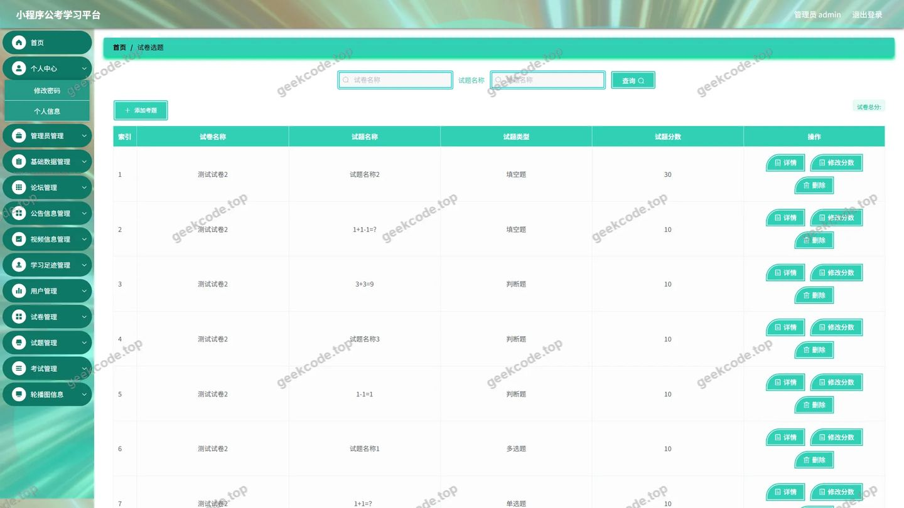</a>

<h4>后台-试题表</h4>

<h4>后台首页</h4>

<a href="https://geekcode.top/archives/%E5%9F%BA%E4%BA%8E%E5%BE%AE%E4%BF%A1%E5%B0%8F%E7%A8%8B%E5%BA%8F%E7%9A%84%E5%85%AC%E8%80%83%E5%AD%A6%E4%B9%A0%E5%B9%B3%E5%8F%B0%E7%9A%84%E8%AE%BE%E8%AE%A1%E4%B8%8E%E5%AE%9E%E7%8E%B0pf?utm_source=github" title="查看完整源码">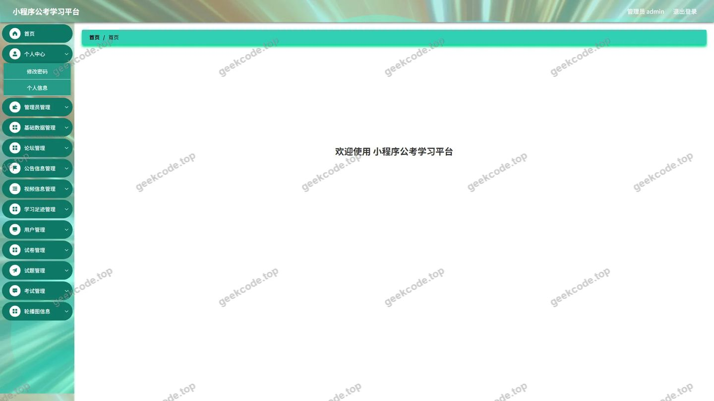</a>

<h4>后台-轮播图</h4>

<a href="https://geekcode.top/archives/%E5%9F%BA%E4%BA%8E%E5%BE%AE%E4%BF%A1%E5%B0%8F%E7%A8%8B%E5%BA%8F%E7%9A%84%E5%85%AC%E8%80%83%E5%AD%A6%E4%B9%A0%E5%B9%B3%E5%8F%B0%E7%9A%84%E8%AE%BE%E8%AE%A1%E4%B8%8E%E5%AE%9E%E7%8E%B0pf?utm_source=github" title="查看完整源码">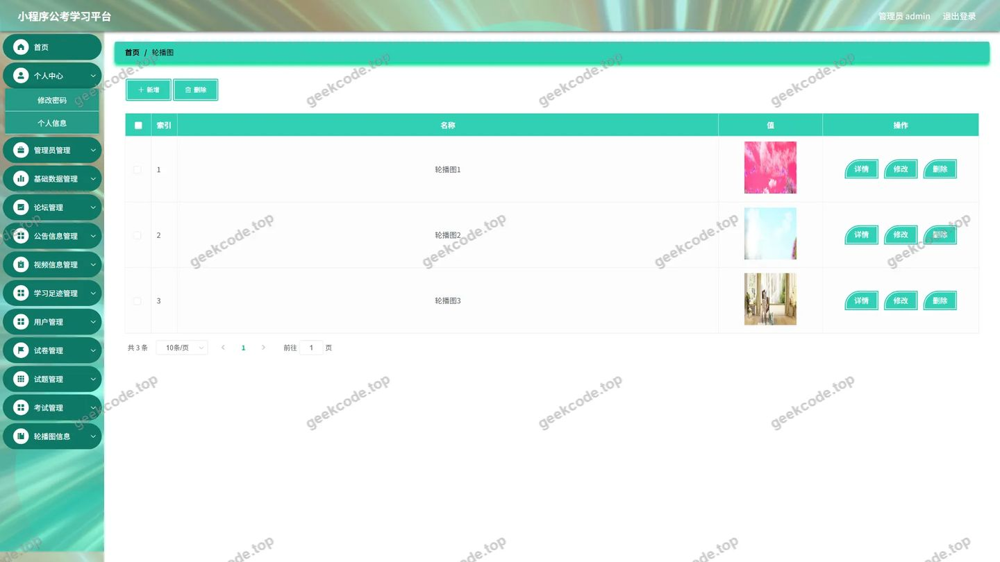</a>

<h4>后台-学习足迹</h4>

<a href="https://geekcode.top/archives/%E5%9F%BA%E4%BA%8E%E5%BE%AE%E4%BF%A1%E5%B0%8F%E7%A8%8B%E5%BA%8F%E7%9A%84%E5%85%AC%E8%80%83%E5%AD%A6%E4%B9%A0%E5%B9%B3%E5%8F%B0%E7%9A%84%E8%AE%BE%E8%AE%A1%E4%B8%8E%E5%AE%9E%E7%8E%B0pf?utm_source=github" title="查看完整源码">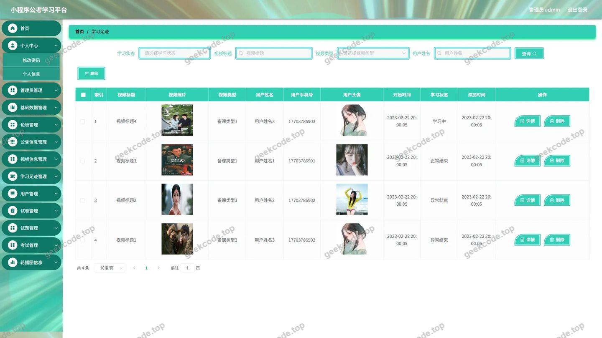</a>

---

## 获取完整源码

| 项目 | 说明 |
| --- | --- |
| 项目名 | 基于微信小程序的公考学习平台的设计与实现pf |
| 运行截图 | 本文 13 张（站点带水印原图，仓库 `images/` 目录） |
| 完整源码 | [https://geekcode.top/archives/%E5%9F%BA%E4%BA%8E%E5%BE%AE%E4%BF%A1%E5%B0%8F%E7%A8%8B%E5%BA%8F%E7%9A%84%E5%85%AC%E8%80%83%E5%AD%A6%E4%B9%A0%E5%B9%B3%E5%8F%B0%E7%9A%84%E8%AE%BE%E8%AE%A1%E4%B8%8E%E5%AE%9E%E7%8E%B0pf?utm_source=github](https://geekcode.top/archives/%E5%9F%BA%E4%BA%8E%E5%BE%AE%E4%BF%A1%E5%B0%8F%E7%A8%8B%E5%BA%8F%E7%9A%84%E5%85%AC%E8%80%83%E5%AD%A6%E4%B9%A0%E5%B9%B3%E5%8F%B0%E7%9A%84%E8%AE%BE%E8%AE%A1%E4%B8%8E%E5%AE%9E%E7%8E%B0pf?utm_source=github) |
| 咨询微信 | **ir9372**（备注：jingpin-yuanma） |
| 更多项目 | [极客代码 geekcode.top](https://geekcode.top/?utm_source=github) |

> 需要源码、部署、改配置、跑不起来等问题，加微信 ir9372 沟通，说明项目名即可。
